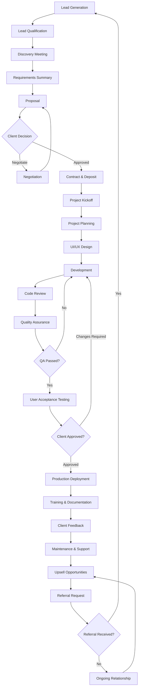

This is exactly the kind of system every software agency should build before trying to scale.

Instead of thinking of yourselves as "developers who need clients", think of yourselves as a **business operating system**.

A successful software company is essentially composed of five interconnected systems:

- Marketing System → Generates opportunities.
    
- Sales System → Converts opportunities into paying clients.
    
- Delivery System → Produces excellent software on time.
    
- Customer Success System → Keeps clients happy.
    
- Growth System → Turns happy clients into recurring revenue and referrals.
    

---

# PART 1 — COMPANY WORKFLOW (Agency Operating System)

```text
Lead Generation
      ↓
Lead Qualification
      ↓
Discovery Meeting
      ↓
Proposal
      ↓
Negotiation
      ↓
Contract + Invoice
      ↓
Kickoff Meeting
      ↓
Project Planning
      ↓
Design
      ↓
Development
      ↓
QA
      ↓
Deployment
      ↓
Training
      ↓
Feedback
      ↓
Maintenance
      ↓
Upsell
      ↓
Referral
```

---

# 1. Lead Generation

## Goal

Generate qualified business opportunities every day.

### Responsible

Marketing + Sales

### Inputs

- Content
- Outreach
- Ads
- Referrals
- Marketplace profiles

### Outputs

New Lead

### Documents

- CRM Record
- Lead Source
- Contact Information
    

### Checklist

 Company Name

- [ ] Website

- [ ] Industry

- [ ] Contact Person

- [ ] Email

- [ ] Phone

- [ ] Estimated Company Size

- [ ] Source

### KPI

- Leads/week
- Cost per Lead
- Meetings booked
- Response Rate
    

---

# 2. Lead Qualification

## Goal

Avoid wasting time with bad leads.

Use BANT.

- Budget
- Authority
- Need
- Timeline
    

### Responsible

Sales

### Inputs

Lead

### Outputs

Qualified Opportunity

### Documents

Qualification Form

### Checklist

- [ ] Has budget

- [ ] Decision maker

- [ ] Real problem

- [ ] [] Timeline

- [ ] Fits services

### KPI

Qualified Lead Rate

---

# 3. Discovery Meeting

## Goal

Understand the business.

Never jump directly to price.

Ask:

- Current process?
- Pain points?
- Users?
- Goals?
- Timeline?
- Budget?
- Success metrics?
- Competitors?
- Existing software?
- Integrations?

### Responsible

Sales + PM

### Outputs

Requirement Summary

### Documents

Discovery Notes

Meeting Recording

### KPI

Proposal Conversion

---

# 4. Proposal

Goal:

- Show business value.

- Proposal includes:
	- Executive Summary
	- Problem
	- Solution
	- Timeline
	- Deliverables
	- Technology
	- Milestones
	- Payment Plan
	- Support
	- Price
	- Next Steps

Responsible:
- Sales

Outputs:
- Proposal PDF

Checklist

- [ ] Scope

- [ ] Timeline

- [ ] Cost

- [ ] Assumptions

- [ ] Exclusions

- [ ] Warranty

KPI

Proposal Acceptance Rate

---

# 5. Negotiation

Goal

Reach Win-Win

Never discount immediately.

Instead offer:

Less features

Phased delivery

Longer timeline

Maintenance package

### KPI

Win Rate

---

# 6. Contract

Documents

MSA

SOW

NDA

Invoice

Deposit Receipt

KPI

Average Closing Time

---

# 7. Project Planning

Deliverables

WBS

Sprint Plan

Architecture

Milestones

Risk Register

Communication Plan

Definition of Done

KPI

Planning Accuracy

---

# 8. Development

Workflow

Backlog

↓

Sprint

↓

Coding

↓

PR

↓

Review

↓

Merge

↓

Testing

↓

Release

KPIs

Velocity

Cycle Time

Bug Rate

---

# 9. QA

Checklist

Functional

Regression

Performance

Security

Responsive

Cross Browser

Accessibility

KPIs

Bug Escape Rate

---

# 10. Deployment

Checklist

Backup

Migration

Environment Variables

SSL

Monitoring

Rollback Plan

KPIs

Deployment Success

Downtime

---

# 11. Client Feedback

Collect

NPS

Satisfaction

Improvement Requests

Testimonials

KPIs

NPS

CSAT

---

# 12. Maintenance

Services

Bug Fixes

Updates

Monitoring

Security

Backups

Optimization

Monthly Reports

KPIs

Resolution Time

Renewal Rate

---

# 13. Upselling

Offer

Mobile App

Dashboard

ERP

AI Features

Automation

Analytics

Maintenance

Hosting

SEO

Marketing

KPIs

Expansion Revenue

---

# 14. Referral

Ask after successful delivery.

Template:

> We're glad you're happy with the project. Do you know another business that could benefit from similar software? We'd really appreciate an introduction.

KPIs

Referral Rate

---

# PART 2 — MARKETING SYSTEM

Your marketing should follow a simple rule:

**1 Piece of Content → Repurpose Everywhere**

Example:

1 YouTube video

↓

LinkedIn article

↓

5 LinkedIn posts

↓

Instagram carousel

↓

Facebook post

↓

TikTok short

↓

Email newsletter

↓

Blog article

↓

Twitter thread (optional)

---

## LinkedIn

Daily

- Connect with 20 founders
    
- Comment on 10 posts
    
- Publish 1 value post
    
- Send 10 personalized DMs
    

Weekly

- 1 case study
    
- 1 long-form article
    
- 1 client story
    

Monthly

- Webinar or live session
    
- Portfolio update
    
- Analytics review
    

KPIs

- Connection acceptance rate: 30–50%
    
- Reply rate: 10–20%
    
- Meeting booking rate: 3–8%
    
- Content engagement rate: 2–8%
    

Tools

- LinkedIn Sales Navigator
    
- Shield Analytics (optional)
    
- Notion for content planning
    

Common mistakes

- Pitching immediately after connecting
    
- Generic connection requests
    
- Posting only promotional content
    

---

## Facebook

Daily

- Post in relevant business groups
    
- Answer questions
    
- Share project updates
    

Weekly

- Publish educational posts
    
- Go live or host a Q&A
    

Monthly

- Review group engagement and top-performing posts
    

KPIs

- Group engagement
    
- Click-through rate
    
- Inbound inquiries
    

---

## Instagram

Daily

- Carousel with educational tips
    
- Story behind the scenes
    
- Reply to DMs
    

Weekly

- Client success story
    
- Reel demonstrating a feature
    

Monthly

- Profile audit and hashtag review
    

KPIs

- Reach
    
- Saves
    
- DM inquiries
    

---

## TikTok

Daily

- 1 short video
    
- Coding tips
    
- Startup advice
    
- Before/after software demos
    

Weekly

- Trend adaptation
    
- FAQ videos
    

Monthly

- Analyze watch time and retention
    

KPIs

- Watch time
    
- Completion rate
    
- Profile visits
    

---

## YouTube

Weekly

- Publish one in-depth educational video
    
- One YouTube Short every 2–3 days
    

Monthly

- Optimize thumbnails, titles, and playlists
    

KPIs

- Watch hours
    
- Subscribers
    
- Leads from video descriptions
    

---

## SEO & Blogging

Weekly

- Publish one high-quality article targeting a business problem (e.g., "How to Choose an ERP System for a Manufacturing Company")
    
- Refresh one existing article
    

Monthly

- Keyword research
    
- Backlink outreach
    

KPIs

- Organic traffic
    
- Keyword rankings
    
- Form submissions
    

Tools

- Google Search Console
    
- Google Analytics
    
- Ahrefs or SEMrush (when budget allows)
    

---

## Email Marketing

Weekly

- Send one newsletter
    
- Follow up with inactive leads
    

Monthly

- Clean the email list
    
- Test subject lines
    

KPIs

- Open rate: 35–50%
    
- Reply rate: 5–15%
    
- Meeting booking rate: 2–5%
    

---

## Cold Outreach (Email, DM, LinkedIn)

Daily

- Research 30 prospects
    
- Send 20–30 personalized messages
    
- Follow up with previous contacts
    

Weekly

- Review response patterns
    
- Improve messaging
    

Monthly

- A/B test outreach templates
    

Typical conversion (well-targeted B2B)

|Stage|Typical Rate|
|---|--:|
|Reply Rate|8–20%|
|Discovery Booked|3–10%|
|Proposal Sent|50–70% of meetings|
|Closed Deals|20–35% of proposals|

Common mistakes

- Mass messaging
    
- No personalization
    
- Following up only once
    

---

## Networking

Activities

- Attend local startup events
    
- Join founder meetups
    
- Speak at technical communities
    
- Exchange introductions
    

KPI

- Qualified introductions per month
    

---

## Referrals

Ask every satisfied client within two weeks of successful delivery.

KPI

- Referral requests made
    
- Referral conversion rate
    

---

## Communities

Participate in:

- Reddit (where appropriate)
    
- Indie Hackers
    
- Facebook founder groups
    
- Slack and Discord startup communities
    

Goal

Become known as someone who solves problems rather than someone who sells.

---

## Upwork, Freelancer & Fiverr

Daily

- Submit 5–10 highly customized proposals
    
- Improve profile with recent work
    
- Respond quickly to invitations
    

KPIs

- Proposal-to-interview rate
    
- Interview-to-contract rate
    
- Client rating
    

---

## Google Business Profile

Weekly

- Publish updates
    
- Add portfolio images
    
- Respond to reviews
    

Monthly

- Request new client reviews
    
- Review local search performance
    

KPIs

- Calls
    
- Website clicks
    
- Review count and average rating
    

---

# PART 3 — SALES SYSTEM

## Lead Qualification

Use BANT plus Technical Fit.

Questions:

- What business problem are you solving?
    
- What happens if you don't solve it?
    
- Who approves the project?
    
- What budget range have you allocated?
    
- When do you want to launch?
    

---

## Discovery Call Script

1. Build rapport (5 min)
    
2. Understand the business
    
3. Explore pain points
    
4. Discuss goals and success metrics
    
5. Review existing systems
    
6. Discuss timeline
    
7. Discuss budget
    
8. Explain your approach
    
9. Agree on next steps
    

---

## Needs Assessment

Document:

- Business objectives
    
- Users
    
- Features
    
- Integrations
    
- Risks
    
- Constraints
    
- Success criteria
    

---

## Budget Discussion

Instead of asking "What's your budget?", ask:

- "What investment range have you planned for solving this problem?"
    
- "If we proposed the right solution, what budget would be comfortable?"
    

---

## Handling Objections

- **Too expensive:** Reduce scope or phase delivery instead of discounting.
    
- **Need to think:** Agree on a follow-up date and summarize the value discussed.
    
- **Comparing competitors:** Focus on outcomes, communication, and long-term support rather than price.
    

---

## Proposal Structure

1. Executive Summary
    
2. Business Challenge
    
3. Proposed Solution
    
4. Scope
    
5. Timeline
    
6. Team
    
7. Deliverables
    
8. Pricing
    
9. Assumptions
    
10. Exclusions
    
11. Acceptance Process
    
12. Next Steps
    

---

## Pricing Strategy

Offer three tiers:

|Package|Best For|
|---|---|
|Starter|Small MVPs|
|Professional|Growing businesses|
|Enterprise|Large custom solutions|

---

## Follow-up Sequence

- Day 2: Confirm receipt and answer questions.
    
- Day 5: Share a relevant case study.
    
- Day 10: Ask if priorities have changed.
    
- Day 15: Offer a brief call.
    
- Day 30: Reconnect with new insights or examples.
    

---

## Closing Techniques

- Next-step close
    
- Pilot project close
    
- Milestone-based close
    
- Limited-capacity close (only if truthful)
    

---

## Referral Request

Ask after successful delivery, ideally when the client expresses satisfaction.

---

# PART 4 — PROJECT MANAGEMENT

Workflow:

Product Backlog → Sprint Planning → Development → Code Review → QA → UAT → Production → Retrospective

Standards:

- **Task Management:** Kanban for support, Scrum for development.
    
- **Sprint Length:** 2 weeks.
    
- **Communication:** Daily stand-up (15 min), Slack/Teams for async updates.
    
- **Code Review:** Every pull request requires at least one reviewer.
    
- **Testing:** Unit, integration, regression, and user acceptance testing.
    
- **Documentation:** Requirements, architecture, APIs, deployment steps, and handover guide.
    
- **Deployment:** CI/CD with staging before production.
    
- **Weekly Meetings:** Sprint review and retrospective.
    
- **Client Updates:** Weekly status report covering progress, risks, blockers, and next steps.
    

---

# PART 5 — TEAM ROLES

|Role|Primary Responsibilities|
|---|---|
|CEO|Strategy, partnerships, finance, hiring, key client relationships|
|Project Manager|Planning, scheduling, risk management, client communication|
|Sales|Prospecting, discovery calls, proposals, negotiations, closing|
|Marketing|Content, SEO, social media, campaigns, analytics|
|Backend Developer|APIs, business logic, databases, integrations|
|Frontend Developer|Web UI, responsive design, accessibility|
|Mobile Developer|Native or cross-platform mobile applications|
|UI/UX Designer|User research, wireframes, prototypes, design system|
|QA Engineer|Test planning, manual/automated testing, release validation|
|Graphic Designer|Brand assets, social graphics, marketing visuals|
|Content Creator|Blog posts, videos, newsletters, case studies|

---

# PART 6 — SOP LIBRARY

### Getting a New Lead

1. Capture lead in CRM.
    
2. Assign owner within 15 minutes.
    
3. Research the company.
    
4. Send acknowledgment.
    
5. Schedule qualification.
    

### Replying to Inquiries

- Respond within 1 business hour.
    
- Personalize the response.
    
- Include a scheduling link.
    

### Discovery Meeting

- Review the client's business beforehand.
    
- Use a structured question list.
    
- Summarize requirements within 24 hours.
    

### Writing Proposals

- Reuse a standard template.
    
- Customize scope and pricing.
    
- Review internally before sending.
    

### Starting a Project

- Sign contract.
    
- Receive deposit.
    
- Create repository.
    
- Set up project management workspace.
    
- Hold kickoff meeting.
    

### Daily Standups

- What was completed?
    
- What is planned?
    
- Any blockers?
    

### Weekly Review

- Progress vs. plan.
    
- Budget status.
    
- Risks.
    
- Client feedback.
    
- Action items.
    

### Client Communication

- Weekly update.
    
- Immediate escalation for critical issues.
    
- Meeting notes sent within 24 hours.
    

### Project Delivery

- Final QA.
    
- Production deployment.
    
- Handover documentation.
    
- Training session.
    
- Client sign-off.
    

### Maintenance

- Monitor systems.
    
- Prioritize incidents.
    
- Apply updates.
    
- Deliver monthly maintenance report.
    

### Requesting Testimonials

- Ask after successful delivery.
    
- Provide simple guiding questions.
    
- Request permission to publish.
    

### Referral Process

- Thank the client.
    
- Explain your ideal customer profile.
    
- Ask for one introduction.
    
- Follow up with appreciation regardless of outcome.
    

---

# PART 7 — DASHBOARD

|Area|Core KPIs|
|---|---|
|Marketing|Website traffic, inbound leads, content output, cost per lead, conversion by channel|
|Sales|Qualified leads, meetings booked, proposal acceptance, win rate, average sales cycle, average deal size|
|Projects|Sprint velocity, on-time delivery, defect rate, utilization, client satisfaction|
|Finance|Monthly recurring revenue, cash flow, gross margin, accounts receivable, profit margin|
|Customer Success|CSAT, NPS, renewal rate, churn, referral rate, upsell revenue|

---

# PART 8 — RECOMMENDED STARTUP TOOL STACK

|Category|Recommended Tool|
|---|---|
|CRM|HubSpot CRM (Free)|
|Task Management|Jira or ClickUp|
|Documentation|Notion|
|Meetings|Google Meet|
|Design|Figma|
|Marketing|Buffer or Metricool|
|Email|Google Workspace|
|Automation|n8n (self-hosted) or Make|
|Cloud Storage|Google Drive|
|Git|GitHub|

---

# Complete Agency Workflow (Mermaid)



This operating system gives your agency a repeatable process from the first prospect through long-term client retention. As your team grows, each stage can be owned by a dedicated role while the KPIs provide visibility into where leads, deals, or projects are getting stuck, allowing you to improve the system continuously.